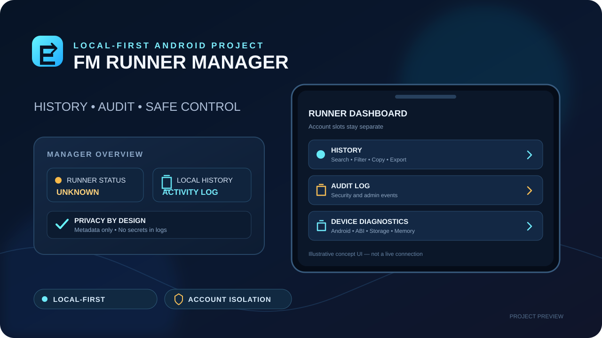

# FM Runner Manager

> Project-preview artwork only; it does not indicate that live runner connectivity or all planned features are implemented.

**Private, local-first Android app** for the eventual monitoring and management of self-hosted GitHub Actions runners on an Android device.

## Current foundation

- Four separately editable local account labels.
- Android version/API, supported ABI, internal storage, available RAM, and external-storage-state diagnostics.
- Copy diagnostics report to clipboard by explicit user action.
- Local metadata-only audit log for account-label changes and report copies.
- GitHub App Device Flow and read-only metadata client are implemented in source.
- GitHub tokens are encrypted at rest with an Android Keystore-backed AES-GCM vault; only the selected account token is intended to remain in memory.
- Runner registration, workflow dispatch, an independent FM runner runtime, and active Start/Stop remain unimplemented.

## Purpose

Provide one mobile dashboard for up to four separately authorized GitHub identities, with clear isolation between accounts, repositories, runner registrations, credentials, and audit events.

## Safety rules

- **Default deny:** no GitHub action, account connection, package installation, workflow dispatch, or runner registration without explicit user action and authorization.
- **Account isolation:** never share tokens, runner registration tokens, work directories, or configuration between identities.
- **Least privilege:** use fine-grained credentials with the smallest necessary scope; do not store personal access tokens in source code, logs, or plain-text preferences.
- **No billing bypass:** the app cannot bypass GitHub billing, spending limits, repository permissions, or organization policy.
- **Package safety:** inspect the environment first. Do not blindly run `apt`, `dpkg`, root commands, or unattended installers. Explain required permissions and obtain approval before installation.
- **Audit and recovery:** record action metadata without logging secrets or project payloads. Preserve a recovery path before configuration changes.
- **Resource-aware:** prefer one active job at a time initially; provide low-data mode and avoid automatic reruns.

## Four-account model

The four slots are local display labels, not pre-authorized identities. Each account must be connected by the owner and verified independently. No account is inferred from another account's login session.

## Adapter design

See [GITHUB-RUNNER-ADAPTER-DESIGN.md](docs/GITHUB-RUNNER-ADAPTER-DESIGN.md) for the independent FM architecture, encrypted credential vault, policy enforcement gates, and acceptance criteria. DroidRunner is a separate app and is reference material only; this project must not integrate with or control it.

## Current UI upgrade — feature branch only

The UI upgrade is being promoted to `main` through a dedicated integration branch; device-level GitHub Device Flow verification remains pending.

- Dark navy dashboard with cyan accent, rounded panels, and quick access to History and Audit Log.
- Local Activity History: timestamp, action, result, and account slot; search; explicit date filter; action/result filters; copy filtered results; CSV-style export/share; confirmation before clearing.
- History is stored separately from the security Audit Log. Clearing History does not clear Audit Log.
- Device diagnostics, four account-label slots, runner/job availability notice, disabled Start/Stop controls, power/job policy preferences, refresh, and copy diagnostics remain present.
- History stores metadata only. It must not store passwords, tokens, or project/message contents.
- UI-only policy preferences are labelled as local settings; they do not enforce runner behavior until a real policy gate is integrated at the runner runtime.

## Planned modules

1. Runner dashboard: Online / Offline / Busy / Error, last check, latest job result.
2. Account & repository registry: four isolated profiles and explicit permission status.
3. Device diagnostics and report export.
4. Package readiness: detect required tools and versions; report missing items before proposing installation.
5. Runner setup guide and registration checks without exposing registration tokens.
6. Workflow activity: job status and links, with manual refresh and opt-in dispatch.
7. Audit / restore: metadata-only log and configuration backup before changes.
8. English-first interface with Urdu language option.

## Verification status

This remains a **foundation scaffold, not a production runner manager**. An Android Keystore-backed credential vault and encrypted session persistence have now been added on the independent feature branch, but compile/build and device verification have not been performed for these changes. The independent FM runner runtime, foreground service, live runner execution, policy enforcement at job admission, package installation, and release signing remain unimplemented or unverified. Do not paste secrets into Issues, commits, or chat. See [IMPLEMENTATION-STATUS.md](docs/IMPLEMENTATION-STATUS.md).

## Development approach

- Kotlin + Android Gradle Plugin.
- Build and verify on a separate feature branch before any merge to `main`.
- Never modify other repositories as part of this project.
- Do not claim a runner is online or a package is installed unless a live check confirms it.
